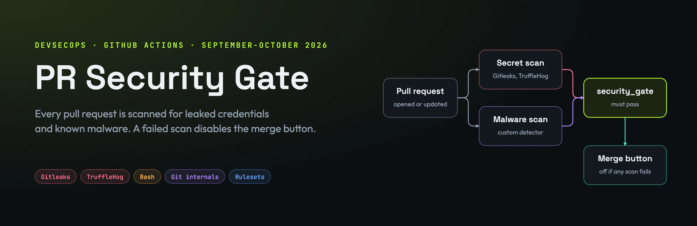
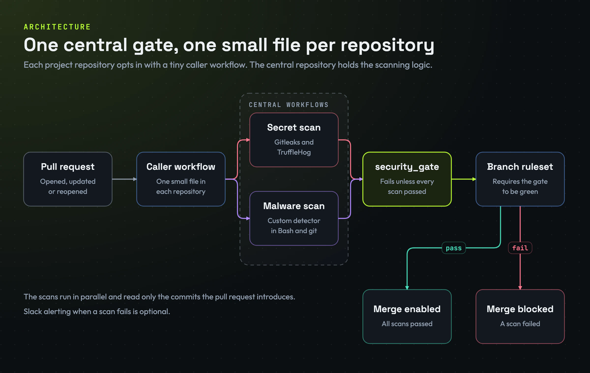
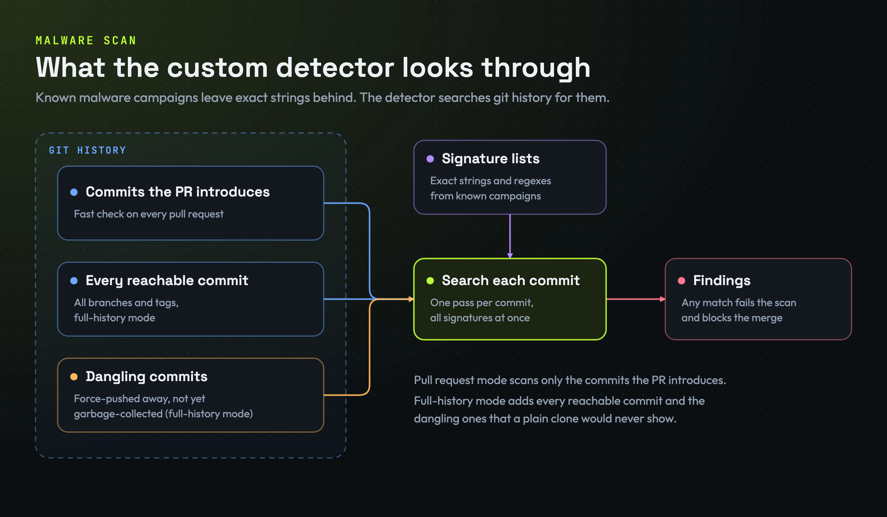
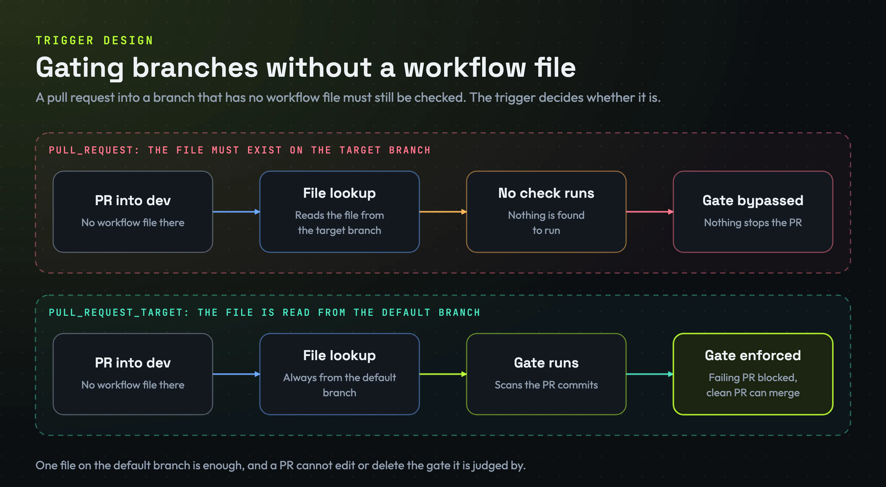
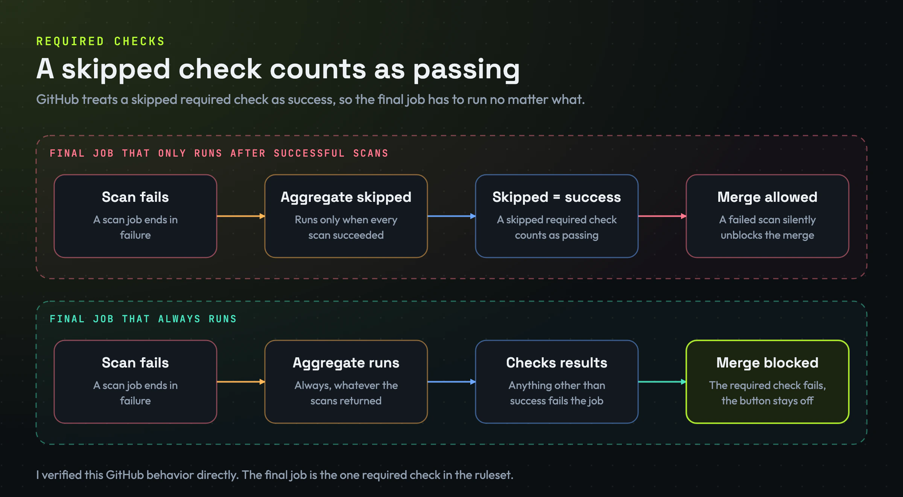
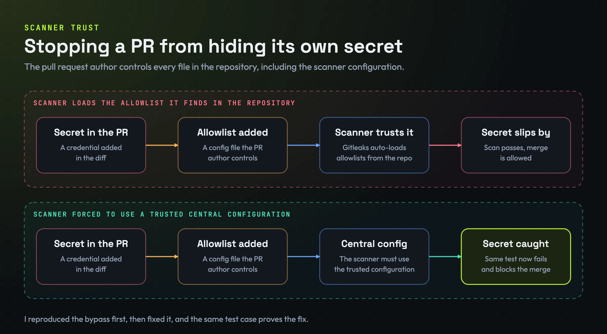
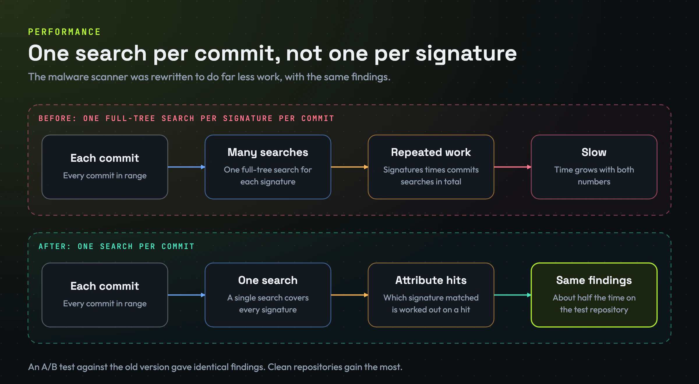
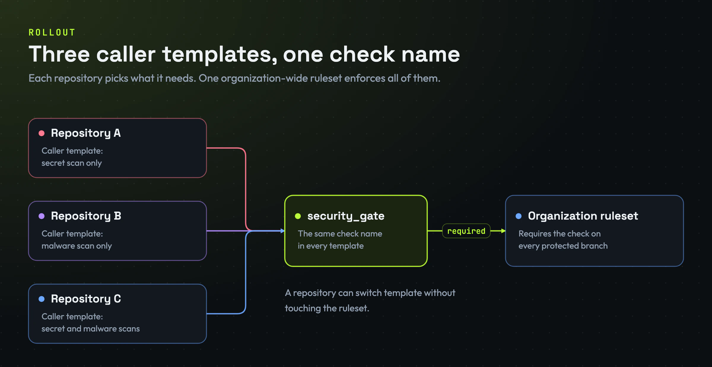

  

# PR Security Gate: Automated Secret and Malware Scanning for Multi-Repo Teams

> A centrally managed GitHub Actions pipeline that scans every pull request for leaked credentials and known malware, and blocks the merge when it finds something.

| | |
| --- | --- |
| **What it is** | One central scanning platform that every repository opts into with a single small file |
| **What it checks** | Leaked credentials and known malware campaigns in every pull request |
| **What it decides** | Whether the merge button is enabled |
| **Status** | Piloted on a production repository, templates ready for the wider rollout |
| **Period** | September-October 2026 |
| **Built** | Designed, built, tested and documented end to end |

> **About this repository:** it describes the design and the decisions behind it. It contains no source code; the implementation itself is not published here.

## Contents

- [Overview](#overview)
- [The problem](#the-problem)
- [The solution](#the-solution)
- [How a pull request is checked](#how-a-pull-request-is-checked)
- [The malware detector](#the-malware-detector)
- [Engineering highlights](#engineering-highlights)
- [Validation](#validation)
- [Tech stack](#tech-stack)
- [What I learned](#what-i-learned)

## Overview

A software agency maintains many repositories for different clients. Leaked credentials and malicious commits are a real risk in that setup, and copy-pasted per-repo scanning drifts out of date.

I built one central scanning platform that every repository opts into with a single small file. Each pull request is scanned automatically, and the result decides whether the merge button is enabled.

## The problem

- Security scanning was either missing or duplicated per repository, and each copy drifted.
- Scanning only the latest code misses secrets and malware that were committed and later removed.
- Developers needed fast feedback on a pull request, not a nightly report.
- Teams needed to choose per repository: secrets only, malware only, or both.

## The solution

A central repository holds the scanning logic as reusable workflows, scripts and signature lists. A tiny caller workflow in each project repository triggers them.

  

Two scanners run in parallel on every pull request:

| Scanner | How it works |
| --- | --- |
| **Secret scan** | Gitleaks (pattern and entropy based) plus TruffleHog, which also verifies whether a found credential is still live. Only the commits introduced by the pull request are scanned. |
| **Malware scan** | A custom detector I wrote in Bash and git. It searches git history for indicators of known malware campaigns, using exact strings and regular expressions. In full-history mode it also checks dangling commits that were force-pushed away but not yet garbage-collected. |

A final aggregate job, the single required status check, fails unless every scan passed. A GitHub branch ruleset requires that check, so a failing pull request cannot be merged. Slack alerting is optional.

## How a pull request is checked

1. A pull request is opened, updated or reopened.
2. The small caller workflow in the project repository starts the central reusable workflows.
3. The secret scan and the malware scan run in parallel, each reading only the commits the pull request introduces.
4. The aggregate job collects every result. Anything other than success makes it fail.
5. The branch ruleset requires that one check, so the merge button is enabled only when all scans passed.
6. If a scan fails, an optional Slack alert is sent.

## The malware detector

The secret scanners are off-the-shelf tools. The malware scan is a detector I wrote, because known malware campaigns leave very specific traces that generic scanners do not look for.

  

- **Signatures:** lists of exact strings and regular expressions taken from known malware campaigns.
- **Pull request mode:** a fast check of only the commits the pull request introduces.
- **Full-history mode:** every reachable commit, plus dangling commits that were force-pushed away but not yet garbage-collected. A scan of the latest code, or a plain clone, would never show them.
- **Result:** any match fails the scan and blocks the merge.

## Engineering highlights

### Gating branches without a workflow file

A normal `pull_request` workflow only runs if its file exists on the branch the pull request merges into. That would mean copying the file onto every branch that needs gating.

I tested the alternative trigger `pull_request_target` in a throwaway repository: it reads the workflow from the default branch only. A failing pull request into a branch with no workflow was blocked, and a clean pull request was mergeable. So a repository needs one file, not one per branch, and a pull request cannot edit the gate it is judged by.

  

### A skipped check counts as passing

GitHub treats a skipped required check as success, so a failed scan could silently unblock a merge. The aggregate job runs unconditionally and fails on any result other than success. I verified this behavior directly.

  

### Stopping a pull request from hiding its own secret

Gitleaks auto-loads allowlist files from the scanned repository, and the pull request author controls that repository. I reproduced the bypass, then forced the scanner to use a trusted central configuration. The same test now catches the secret.

  

### Fail-closed design

A security control that fails quietly is worse than none, because it reports a clean result it never checked.

| Failure | Before | Now |
| --- | --- | --- |
| A clone fails | Looked like a clean result | Fails the run explicitly |
| A scan crashes | Looked like a clean result | Fails the run explicitly |
| A detection pattern is invalid | Looked like a clean result | Fails the run explicitly |

### CI hardening

| Measure | Why |
| --- | --- |
| Removed script-injection paths: branch names and inputs are no longer pasted into shell commands | Attacker-controlled text cannot turn into commands |
| Scanner versions and third-party actions pinned to fixed versions | An upstream change cannot silently alter the gate |
| Job timeouts | A stuck scan cannot hold up the pipeline |
| Least-privilege, read-only token | A compromised step can do little |
| Nothing from a pull request is ever executed with repository secrets | Untrusted code never gets near the secrets |

### Performance

The malware scanner used to run one full-tree search per signature per commit. It now does one search per commit and works out which signature matched only for commits that hit.

  

An A/B test against the old implementation produced identical findings, in roughly half the time on the test repository, with larger gains on clean repositories.

### Modular rollout

Three caller templates (secrets only, malware only, both) share the same check name, so one organization-wide ruleset can enforce any of them.

  

## Validation

End to end on a real repository, using throwaway pull requests:

| Pull request | Result |
| --- | --- |
| A clean change | Passed, merge enabled |
| A change with a dummy secret | Failed, merge button blocked |
| A change containing a known malware indicator | Failed, merge button blocked |
| Each of the above into a branch that had no workflow file | Same results |

Other checks:

- **Equivalence test:** the rewritten malware scanner was compared against the original on a synthetic repository, in full-history and pull request mode.
- **Static checks:** all workflows and templates pass actionlint, and all scripts pass syntax checks.
- **Review:** every change shipped through signed commits and reviewed pull requests.

## Tech stack

| Area | Tools |
| --- | --- |
| CI platform | GitHub Actions: reusable workflows, `pull_request_target`, concurrency, job outputs |
| Merge control | GitHub rulesets and required status checks |
| Secret scanning | Gitleaks, TruffleHog |
| Malware detection | Bash, jq, git internals (`git grep` with PCRE, `fsck` for dangling commits, `rev-list`) |
| Alerting | Slack incoming webhooks |
| Quality | actionlint |

## What I learned

- How GitHub resolves workflow files per trigger.
- How required checks treat skipped jobs.
- How to design a security control that fails closed and cannot be edited by the code it is judging.
